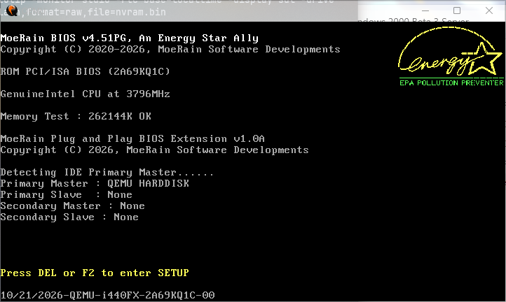
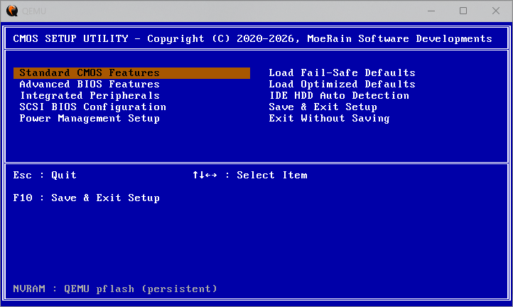

# SeaAwardBIOS

[English](README.MD) | **简体中文**

SeaAwardBIOS 是一个基于 [SeaBIOS](https://www.seabios.org/) 的固件项目，用于在
x86 传统 BIOS 平台上重现 Award BIOS 时代的外观与操作体验。它保留 SeaBIOS 的启动
基础，同时加入 Award 风格的 POST 画面、CMOS Setup 设置程序、启动设备优先级配置，
以及由 QEMU pflash NVRAM 保存的持久化设置。

本项目面向传统 BIOS 模拟、固件开发、复古计算实验和基于 QEMU 的测试。

## 截图

| Award 风格 POST | CMOS Setup 设置程序 |
| :---: | :---: |
|  |  |

## 功能特性

- **Award 风格 POST**：显示 Logo、CPU 与内存检测、IDE 设备摘要、PCI 设备列表、
  DMI 数据池信息和启动设备搜索过程。
- **CMOS Setup 设置程序**：在 POST 阶段按 `Del` 或 `F2` 进入；使用方向键、
  `Page Up`/`Page Down`、`+`/`-`、`Enter` 和 `Esc` 操作。
- **持久化 NVRAM**：设置保存在第二个 256 KiB 的 QEMU pflash 设备中，使用两个
  带校验和、交替写入的闪存扇区。
- **Award 启动顺序控制**：可将第一、第二、第三启动设备设置为 `Floppy`（软驱）、
  `Hard Disk`（硬盘）、`CDROM`（光驱）或 `Network`（网络）。
- **集成外设控制**：可启用或禁用 IDE 通道及设备、USB 控制器、软驱控制器、
  串口和并口。
- **SCSI BIOS 配置**：可启用或禁用 virtio-scsi、LSI 53C895A 和 AMD 53C974A
  扩展 ROM，并查看检测到的 SCSI ID。
- **电源管理**：可启用或禁用 ACPI 支持。
- **启动菜单集成**：在 Award POST 阶段按 `Esc` 可打开 SeaBIOS 启动设备菜单；
  不会重复显示启动菜单。
- **基于 SeaBIOS**：保留 SeaBIOS 的硬件支持、扩展 ROM 处理、SeaVGABIOS 以及
  标准传统 BIOS 接口。

## 快速开始

### 构建环境

- GNU 构建环境：`gcc`、`binutils`、`make`、`python`，以及 POSIX 兼容的
  shell（Linux、WSL、MSYS2 等）。
- x86 QEMU（`qemu-system-x86_64`）。
- 如需使用项目提供的 Windows 启动脚本，需要 PowerShell 7 或更高版本。

### 构建

```bash
make
```

生成的固件镜像位于 `out/bios.bin`，大小应为 256 KiB（262144 字节）。

### 运行并保存设置

在 Windows 上，项目提供的脚本会在首次运行时创建 256 KiB 的 NVRAM 镜像，并使用
两个 pflash 设备启动 QEMU：

```powershell
pwsh -File .\scripts\run-award.ps1
```

可以直接在命令后附加额外的 QEMU 参数：

```powershell
pwsh -File .\scripts\run-award.ps1 -Memory 256M -drive "file=disk.img,format=raw,if=ide"
```

手动运行时，先创建一次 NVRAM 镜像，然后将 BIOS 以只读方式映射、NVRAM 以可写方式
映射并启动 QEMU：

```bash
python3 -c "open('out/nvram.bin','wb').write(b'\xff' * 262144)"

qemu-system-x86_64 -machine pc -m 128M \
  -drive if=pflash,format=raw,readonly=on,file=out/bios.bin \
  -drive if=pflash,format=raw,file=out/nvram.bin
```

> **重要：** Award Setup 需要两个 pflash 设备的布局。仅使用
> `-bios out/bios.bin` 启动时，仍然会显示 Award POST 和 Setup 画面，但设置在
> 断电后无法保留。

## 使用 CMOS Setup 设置程序

在第一个 Award POST 画面显示期间按键：

| 按键 | 功能 |
| --- | --- |
| `Del` 或 `F2` | 进入 CMOS Setup 设置程序 |
| `Esc` | 打开 SeaBIOS 启动设备菜单 |

在 Setup 中：

| 按键 | 功能 |
| --- | --- |
| `↑` / `↓` | 在项目之间移动 |
| `←` / `→` | 在左右菜单栏之间切换 |
| `Enter` | 打开页面、选择值或显示 SCSI ID 列表 |
| `+` / `-` | 切换枚举值 |
| `Page Up` / `Page Down` | 在菜单中翻页 |
| `Esc` | 返回上一级画面，或不保存退出 |
| `F10` | 保存设置并重启 |

### 设置页面

| 菜单 | 选项 |
| --- | --- |
| Standard CMOS Features | 日期、时间、IDE 主/从设备、软驱 A/B、检测到的内存容量 |
| Advanced BIOS Features | 第一/第二/第三启动设备、Boot Other Device、启动时 NumLock 状态 |
| Integrated Peripherals | 板载主/从 PCI IDE、USB 控制器、串口 1/2、并口、软驱控制器 |
| SCSI BIOS Configuration | VirtIO SCSI BIOS、LSI 53C895A SCSI BIOS、AMD 53C974A SCSI BIOS；按 `Enter` 查看检测到的 SCSI ID |
| Power Management Setup | ACPI Function |
| Load Fail-Safe Defaults | 恢复保守默认值（软驱优先、NumLock 关闭） |
| Load Optimized Defaults | 恢复优化默认值（硬盘优先、NumLock 开启） |
| IDE HDD Auto Detection | 显示自动检测到的 IDE 设备 |
| Save & Exit Setup | 将设置写入 NVRAM 并重启 |
| Exit Without Saving | 放弃修改并重启 |

默认启动顺序为 `Hard Disk`、`CDROM`、`Floppy`；Fail-Safe 默认值为 `Floppy`、
`Hard Disk`、`CDROM`。`Boot Other Device` 默认启用。

与硬件相关的设置会在初始化和启动阶段生效：禁用 IDE 通道、软驱控制器、某个 SCSI
扩展 ROM、USB 或 ACPI，会阻止相应设备或服务被初始化。

## NVRAM 与持久化

- 第二个 pflash 设备映射到 `0xfff80000`；SeaAwardBIOS 将地址空间顶部的 512 KiB
  保留给 256 KiB 的 BIOS 和 256 KiB 的 NVRAM。
- 设置以带魔术数和校验和的记录形式保存在两个 4 KiB 闪存扇区之一。保存时交替写入
  两个扇区，并选择最新的有效记录，因此写入中断不会破坏上一次的设置。
- 如果 NVRAM 镜像不存在、无效或为只读，SeaAwardBIOS 会回退到内置默认值，并提示
  设置无法持久保存。
- 删除 `out/nvram.bin` 即可将所有设置恢复为默认值。

## 配置

SeaAwardBIOS 使用标准的 SeaBIOS kconfig 系统：

```bash
make menuconfig
make
```

Award 专用选项为 `CONFIG_AWARD_SETUP`：

> Award-style CMOS setup with QEMU pflash NVRAM

它依赖 `CONFIG_QEMU` 和 `CONFIG_BOOT`，默认启用，并且需要 `CONFIG_BOOTMENU`
才能使用集成的启动菜单。其他 SeaBIOS 选项仍按上游 SeaBIOS 文档正常工作。

## 项目结构

| 路径 | 说明 |
| --- | --- |
| `src/award.c`、`src/award.h` | Award 风格 POST、Setup 界面、NVRAM 记录和设备策略 |
| `src/award_logo.h` | POST Logo 的点阵字体数据 |
| `src/boot.c` | Award 启动顺序集成与启动菜单修改 |
| `src/post.c` | POST 集成与 USB 策略 |
| `src/hw/ata.c`、`src/hw/floppy.c` | IDE 与软驱控制器策略 |
| `src/serial.c`、`src/fw/paravirt.c` | 串口/并口与 ACPI 策略 |
| `scripts/run-award.ps1` | Windows 下双 pflash QEMU 布局的启动脚本 |
| `assets/docs/` | 文档中使用的截图 |
| `docs/` | SeaBIOS 开发者文档 |

## 文档

- [构建概览](docs/Build_overview.md)
- [执行流程与代码流程](docs/Execution_and_code_flow.md)
- [内存模型](docs/Memory_Model.md)
- [开发者文档](docs/Developer_Documentation.md)
- [SeaVGABIOS](docs/SeaVGABIOS.md)
- [贡献指南](docs/Contributing.md)
- [上游 SeaBIOS 文档](https://www.seabios.org/Developer_Documentation.html)

## 贡献

SeaAwardBIOS 遵循 SeaBIOS 的贡献流程。补丁应先在本地测试，并包含使用真实姓名和
当前电子邮箱的 `Signed-off-by` 行，表示同意开发者原创证书（DCO）。详情请参阅
[docs/Contributing.md](docs/Contributing.md)。

## 许可证

SeaAwardBIOS 基于 SeaBIOS，按 GNU Lesser General Public License 第 3 版或更高
版本发布。完整许可证文本请参阅 [COPYING.LESSER](COPYING.LESSER) 和
[COPYING](COPYING)。

SeaAwardBIOS 是独立项目，与 Award Software 无隶属关系，也未获得其认可。
"Award" 仅用于描述兼容性视觉风格。
